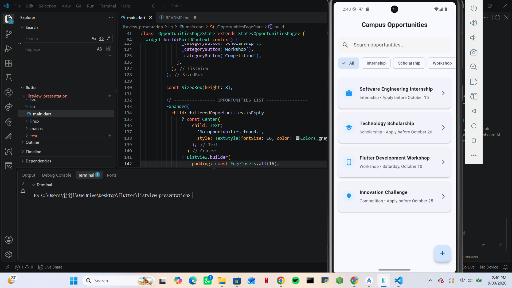
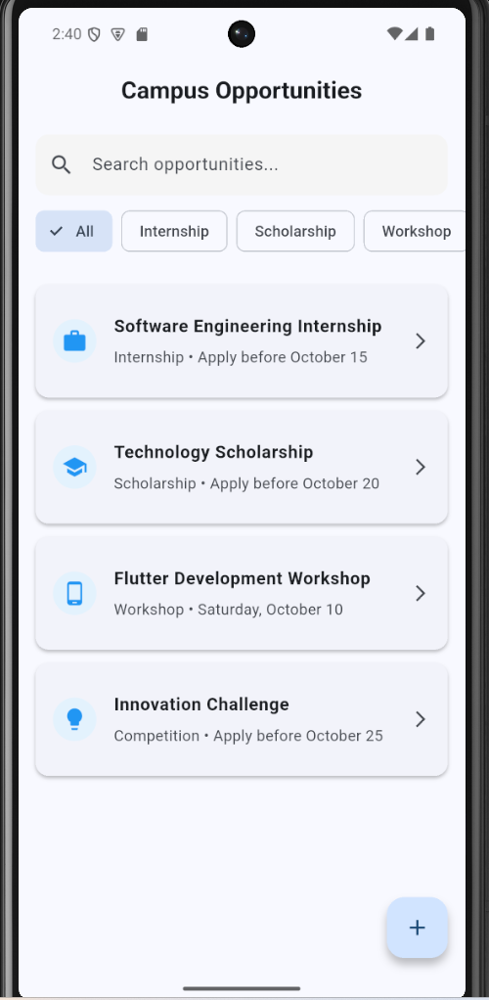

# Widget Description
I created a small Flutter app called campus opportunities that demonstrates the ListView widget.

How to Run

1. Clone the repository.
2. Open the project in VS Code or Android Studio.
3. Open the project terminal.
4. Run this command 'flutter pub get'
5. Start an Android emulator or connect an Android device.
6. Then Run this command 'flutter run' it will open in you android device.

# Here are three ListView Properties i focused on

1. scrollDirection

scrollDirection controls the direction in which a ListView scrolls. In the category list, I used Axis.vertical so the category items are arranged vertically.

 2. padding

padding adds space around the contents of the ListView. I used EdgeInsets.all(16) for the main opportunity list so the cards have space around them.

3. itemCount

itemCount specifies the number of items that ListView.builder should create. I used filteredOpportunities.length so the number of displayed opportunities matches the search and category filtering results.

Screenshot

